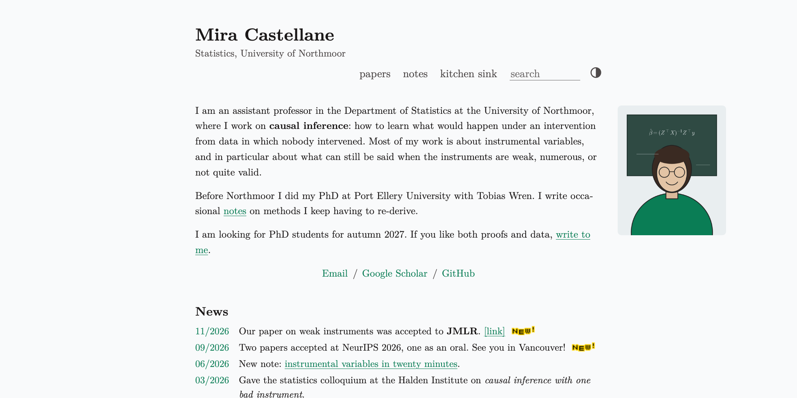

# Camera Ready

An academic homepage and blog for [Zola](https://www.getzola.org) that looks
like a LaTeX paper.



**[Live demo](https://uzairakbar.github.io/camera-ready/)** ·
[Kitchen sink](https://uzairakbar.github.io/camera-ready/blog/kitchen-sink/)

- **A homepage that gets to the point.** Name and links in one header line,
  bio beside a portrait, dated news, selected works with thumbnails, and
  CV-style lists for experience, service and teaching.
- **You write markdown and edit data files.** Publications come from your
  `.bib` file, news from a small TOML file. You never touch HTML.
- **One typeset look on every page.** Homepage, publication list, blog index and
  posts share the Latin Modern typeface, an 80-character column and one accent
  colour, courtesy of [LaTeX.css](https://latex.vercel.app).
- **Built to be left alone.** Nothing is loaded from another site: no CDN, no
  web-font service, no analytics. Building needs only the Zola binary. The
  pages work with JavaScript switched off.
- **Made for people who write maths.** Theorems, proofs, sidenotes, numbered
  equations, margin footnotes, highlighted code, figures and tables.

The demo content is fictional. Mira Solane, her papers and her university
do not exist.

## Contents

- [Quick start](#quick-start)
- [Writing](#writing)
- [Publications, news and projects](#publications-news-and-projects)
- [Configuration](#configuration)
- [Deploying](#deploying)
- [LaTeX.css coverage](#latexcss-coverage)
- [Designed to last](#designed-to-last)
- [Troubleshooting](#troubleshooting)
- [Credits and licences](#credits-and-licences)

## Quick start

You need [Zola](https://www.getzola.org/documentation/getting-started/installation/)
0.23 or newer (the theme is developed against 0.23.6) and git.

```sh
mkdir my-site && cd my-site
git init
git submodule add https://github.com/uzairakbar/camera-ready themes/camera-ready

# Start from the demo site: its pages, its data files and its config.
cp -r themes/camera-ready/content themes/camera-ready/data .
sed -e 's|^# theme = |theme = |' \
    -e 's|"syntax/|"themes/camera-ready/syntax/|g' \
    themes/camera-ready/zola.toml > zola.toml

zola serve
```

Open <http://127.0.0.1:1111>. You now have a working copy of the demo. Make it
yours by editing four things:

| File | What it holds |
|---|---|
| `zola.toml` | Your name (`title`), address (`base_url`), links, menu and options |
| `content/_index.md` | Your bio, in markdown |
| `data/publications.bib` | Your papers |
| `data/news.toml`, `data/projects.toml`, `data/misc.toml` | News, projects, and the lists at the foot of the page. Delete a file to drop its section |
| `data/authors.toml` | Optional: co-authors' pages, linked in author lists |

Replace `content/img/portrait.png` with your own picture (or set `photo = ""`),
delete the demo posts in `content/blog/`, and write your own. To publish, see
[Deploying](#deploying).

## Writing

A post is a markdown file in `content/blog/` with a title and a date:

```markdown
+++
title = "Instrumental variables"
date = 2026-11-20
description = "One line for the blog index."

[extra]
abstract = "Optional. Set like the abstract of a paper."
toc = true          # optional table of contents
+++

Ordinary paragraph with inline maths $`\beta = (Z^\top X)^{-1} Z^\top y`$.
```

If a post has images, make it a folder: `content/blog/my-post/index.md`, with
the images beside it.

The section is called "Blog" only because `content/blog/_index.md` says so.
Change its `title` to "Blog", rename the folder, and update the `menu` entry.

### Maths

Write TeX between dollar signs **and backticks**:

| You write | You get |
|---|---|
| `` $`x_i^2`$ `` | inline maths |
| `` $$`\int_0^1 f(x)\,dx`$$ `` | a display equation; may span several lines |

The backticks are what make this reliable. Without them markdown reads `_`,
`*` and `\\` in a formula as formatting and silently changes it. Everything
[KaTeX supports](https://katex.org/docs/supported.html) works, including
`align` and numbered `equation` environments. Wide displays scroll sideways.

### Components

Blocks that markdown has no syntax for are written as components. Leave a
blank line between a component's tags and other paragraphs.

```jinja

Under relevance and exclusion, $`\beta`$ is identified.



Take covariances with $`z`$.


A claim.Set in the margin; tap-to-open on a phone.

{{ <figure src="plot.png" caption="A *numbered* caption." alt="What it shows." /> }}
```

| Component | Options | Notes |
|---|---|---|
| `theorem`, `lemma`, `proposition`, `corollary` | `name`, `id` | Numbered together, italic body |
| `definition`, `example` | `name`, `id` | Numbered, upright body |
| `remark` | `name`, `id` | Not numbered |
| `proof` | `of` | Ends with a QED square. `of="of Theorem 1"` |
| `abstract` | `title` | Or use `abstract = "…"` in front matter |
| `sidenote` | `side="left"`, `symbol="⊕"` | Numbered unless given a symbol |
| `figure` | `src`, `caption`, `alt`, `width`, `max_width`, `dark_invert` | Self-closing. Large images are resized at build time. `dark_invert={true}` is for dark-on-white drawings: the image is inverted in dark mode, keeping its colours |
| `table` | `caption`, `borders` | Wraps a markdown table. `borders` is `booktabs` (default), `grid` or `none` |
| `nowrap`, `breakall`, `smallcaps`, `noindent` | | Rarely needed |

Set `id` to link to a result: ``, then
`[the main theorem](#thm-main)`.

### Footnotes

Markdown footnotes (`[^1]`) work as usual. If you write each definition
directly after the paragraph that uses it, it is set in the margin beside that
paragraph on wide screens and below it on narrow ones. Definitions collected
at the end of the file are set as ordinary footnotes. To always collect them at
the end, with back-links, set `bottom_footnotes = true` under `[markdown]`.

### Everything else

Tables, code blocks, quotations, lists and definition lists are plain
markdown. Column alignment uses markdown's `:--`, `:-:` and `--:`. Code is
highlighted at build time: ` ```python `, with optional `linenos`,
`hl_lines=2-3` and `name=file.py`. A few inline HTML tags are styled if you
need them: `<mark>`, `<kbd>`, `<ins>`, `<sub>`, `<sup>`, `<small>`.

The [kitchen sink](https://uzairakbar.github.io/camera-ready/blog/kitchen-sink/)
shows all of it; its source is
[`content/blog/kitchen-sink/index.md`](content/blog/kitchen-sink/index.md).

## Publications, news and projects

### `data/publications.bib`

Use the BibTeX file you already have. Entries appear in file order.

With up to `papers_limit` entries (20 by default, about what a Google Scholar
profile shows before "Show more") the homepage lists them all under
"Publications". With more, the homepage shows only the entries marked
`selected`, under "Selected works", with a "View all" link to `papers_page`.
Point that at your Google Scholar profile, as the demo does, or keep the full
list on your own site: create `content/papers.md` with
`template = "papers.html"` in its front matter and set
`papers_page = "@/papers.md"`. That page groups everything by year.

 `title`, `author` and `year` are required.
The venue is taken from `booktitle`, `journal`, `howpublished`, `school`,
`institution` or `publisher`. These extra fields are optional:

| Field | Effect |
|---|---|
| `selected = {true}` | Keep on the homepage once you have more than `papers_limit` entries |
| `thumbnail = {img/paper.png}` | Image beside the entry on the homepage (a file in `content/` or `static/`), shown whole, without a frame, no taller than the text beside it. Once one entry has a thumbnail, every row keeps the column, so give each entry one |
| `thumbnail_hover = {img/paper.gif}` | A second image shown while the pointer is on the row, as on Jon Barron's site. Animated GIFs stay animated |
| `dark_invert = {true}` | For a thumbnail in dark ink on white: invert it in dark mode, keeping its colours |
| `blurb = {One sentence.}` | Short description under the entry |
| `abbr = {NeurIPS}` | Short venue name. The homepage shows it with the year as a tag; a full papers page spells the venue out |
| `note = {Oral}` | A second tag after the venue, in `note_color` |
| `status = {In submission}` | A grey tag after the venue |
| `highlight = {true}` | Tint the row |
| `pdf`, `arxiv`, `doi`, `code`, `data`, `slides`, `poster`, `video`, `talk`, `website`, `bibtex` | Links, shown in this order (`website` is labelled "webpage"). A URL, or the path of a file in `static/`. `arxiv` and `doi` also accept a bare identifier |
| `links = {pdf, bibtex}` | Show only these links for this entry, when it has more fields filled in than you want listed |
| `url` | Where the title links to (falls back to `pdf`) |

Your own name is underlined in author lists; list its spellings in
`author_names`. To link co-authors to their pages, add an optional
`data/authors.toml` with lines such as
`"Tobias Wren" = "https://example.org/wren"`. A linked name looks like plain
text and takes the same underline when hovered. Mark equal contribution with an asterisk after a name,
`{Solane*, Mira and Raman*, Priya}`, and a legend is added. Names are
printed as the file has them; set `author_initials = true` to print every
given name as an initial, so a file that mixes "Ada Lovelace" and
"A. Lovelace" comes out consistent. Common LaTeX
accents (`{\"u}`, `{\'e}`) and `$maths$` in titles are understood; anything
more exotic is best written as plain Unicode.

### `data/news.toml`

```toml
[[news]]
date = 2026-11-04
text = "Paper accepted to **JMLR**."     # markdown
link = "https://example.org"              # optional
```

Items are sorted newest first. The first `news_visible` are shown and the rest
fold under "Older". Items younger than `news_recent_days` (90 by default)
carry a small animated "NEW!" (`static/camera-ready-new.gif`; point
`new_badge` at your own image to change it). Visitors who ask for reduced
motion get a still drawing of the same badge instead. The age is worked out when the site is built,
so the deploy workflow rebuilds weekly to let badges expire. Add
`new = true` or `new = false` to an item to decide by hand.

### `data/projects.toml`

```toml
[[projects]]
name = "ivkit"                            # required
url = "https://example.org/ivkit"
thumbnail = "img/ivkit.png"
text = "A small library for IV estimation."
links = [{ name = "code", url = "https://example.org/ivkit" }]
```

### Miscellanea

Experience, students, service, teaching and the like go in `data/misc.toml`
as labelled lists, set like a CV:

```toml
[[groups]]
title = "Teaching"
items = [
  "[Causal Inference STAT 410](https://example.org) @ Northmoor, 2025, 2026",
  "Probability and Statistics STAT 201 @ Northmoor, 2024",
]
```

Each item is one line of markdown; write dates into the line if you want them.

A missing file, or one left out of `home_sections`, simply hides its section.
A malformed file stops the build with a message naming the file and the item.

### Tags

Posts can carry tags. Declare the taxonomy once in `zola.toml`, above the
first `[section]`:

```toml
taxonomies = [{ name = "tags" }]
```

and tag a post in its front matter:

```toml
[taxonomies]
tags = ["causal inference", "statistics"]
```

The blog index then gets a "view by tag" row, each tag gets a page listing
its posts, and a post shows its tags under its date. Leave the taxonomy out
and none of this appears.

## Configuration

Everything goes under `[extra]` in `zola.toml`. All of it is optional.

| Option | Default | Meaning |
|---|---|---|
| `subtitle` | `""` | Small line under your name in the header |
| `links` | `[]` | Your links elsewhere, shown in the footer and under the bio. With `icon` they show as icons in the footer: `[{ name = "GitHub", url = "…", icon = "github" }]`. Icons: `github`, `gitlab`, `linkedin`, `x`, `twitter`, `scholar`, `google-scholar`, `orcid`, `youtube`, `instagram`, `bluesky`, `mastodon`, `email`, `cv`, `rss`, `link` |
| `menu` | `[]` | Top-right navigation: `[{ name = "blog", url = "@/blog/_index.md" }]`. A `url` can also be a file in `static/`, such as `cv.pdf` |
| `links_position` | `"footer"` | Icon links at the right of the footer, or `"header"` to put them after the menu |
| `bio_links` | `true` | Also list `links` as words under the bio: GitHub / Scholar / …. Add `bio = false` to a link to keep it out of that row while its icon stays in the footer |
| `search` | `false` | A small search field in the header, handing the query to DuckDuckGo limited to your site |
| `search_shortcut` | `false` | Let `/` jump to the search field. A few lines of JavaScript; the field works without it |
| `search_site` | from `base_url` | The site to search, if different: `"example.org"` |
| `scheme_toggle` | `false` | A light/dark button in the header. The theme's only JavaScript outside maths; the choice is remembered in the visitor's browser |
| `photo`, `photo_alt` | `""` | Portrait on the homepage |
| `photo_on_phones` | `true` | `false` leaves the portrait out on phone-width screens |
| `photo_position` | `"margin"` | `"margin"` hangs the portrait in the right margin on wide screens, like a sidenote, and moves it into the column on narrow ones. `"inline"` always keeps it in the column |
| `author_names` | site title | Spellings of your name to underline in author lists |
| `authors` | `"data/authors.toml"` | Optional file of co-author names and their pages |
| `home_sections` | `["news", "selected", "projects", "misc"]` | Homepage sections, in order. Remove one to hide it |
| `misc` | `"data/misc.toml"` | Optional file of labelled lists (experience, students, service, teaching) |
| `headings` | | Rename headings: `{ news = "Updates", selected = "Papers" }`. Keys: `news`, `older_news`, `publications`, `selected`, `all_papers`, `projects`, `misc`, `tags`, `tags_title`, `abstract`, `contents` |
| `publications`, `news`, `projects` | `data/…` | Paths of the data files |
| `projects_style` | `"cards"` | Projects as a grid of cards with the image on top; the whole card links to the project's `url`. Or `"rows"`, to match the publication list and show each project's `links` |
| `papers_limit` | `20` | Up to this many publications the homepage lists them all. Past it, only `selected` ones, with a "View all" link to `papers_page`. `0` always uses the selected list |
| `papers_page` | `""` | Target of the "View all" link shown past `papers_limit`: a URL such as your Google Scholar profile, or `"@/papers.md"` for a full list on your own site. Empty for no link |
| `author_initials` | `false` | Print given names as initials in author lists |
| `news_visible` | `5` | News items shown before "Older news" |
| `news_recent_days` | `90` | How long an item is "New!" |
| `new_badge` | `"camera-ready-new.gif"` | Image beside recent news items. `""` uses a built-in drawn badge |
| `news_date_format` | `"%m/%Y"` | Date beside each news item |
| `equal_note` | `"* equal contribution"` | Legend shown when author lists use `*` |
| `accent`, `accent_dark` | `#0a7d55`, `#58d0a3` | The accent colour, for light and dark mode |
| `note_color`, `note_color_dark` | `#b3127a`, `#f58ad0` | Colour of the note tag beside a venue ("Oral", "Spotlight") |
| `color_scheme` | `"auto"` | `"auto"` follows the visitor's system; `"light"` or `"dark"` forces one |
| `font` | `"latin-modern"` | Or `"libertinus"`. Site-wide; only the chosen family is downloaded |
| `justify` | `false` | Justified text |
| `indent_paragraphs` | `false` | First-line indents as in a LaTeX article. Per page: `indent = true` in `[extra]` |
| `numbered_headings` | `false` | Number sections: 1, 1.1, 1.1.1 |
| `show_author` | `true` | Print your name under each post's title. Posts with their own `authors` always show them |
| `date_format` | `"%-d %B %Y"` | Date format on posts |
| `footer` | copyright line | Footer text, markdown |
| `favicon` | `""` | Path of an icon in `static/` |

Three settings live outside `[extra]` because they belong to Zola:

```toml
default_language = "en"       # also selects hyphenation and theorem labels

[markdown]
smart_punctuation = true      # curly quotes, -- to en dash
definition_list = true
bottom_footnotes = false      # see "Footnotes" above

[markdown.highlighting]       # code colours matching LaTeX.css's Prism theme
style = "class"
light_theme = "camera-ready-light"
dark_theme = "camera-ready-dark"
extra_themes = [
  "themes/camera-ready/syntax/camera-ready-light.json",
  "themes/camera-ready/syntax/camera-ready-dark.json",
]
```

Any other [Zola highlighting theme](https://www.getzola.org/documentation/content/syntax-highlighting/)
works too. To change the look beyond these options, create
`static/camera-ready.css` in your site as a copy of the theme's and edit it;
it is a single hand-written stylesheet.

## Deploying

The theme ships a GitHub Actions workflow that builds the site, checks links,
renders the maths, and publishes to GitHub Pages.

```sh
mkdir -p .github/workflows
cp themes/camera-ready/.github/workflows/deploy.yml .github/workflows/
git add -A && git commit -m "First version" && git push
```

Then, on GitHub, open **Settings → Pages** and set **Source** to
**GitHub Actions**. The site is rebuilt on every push to `main` and once a
week. Set `base_url` in `zola.toml` to your address if you use a custom
domain.

Anywhere else: run `zola build` and upload the `public/` folder. It is a
plain folder of static files.

### The maths step

Maths is rendered by a copy of [KaTeX](https://katex.org) that lives inside
the theme. There are two ways it can run, and both give identical output:

- **At build time** (what the workflow does):
  `node themes/camera-ready/scripts/prerender-math.js public` rewrites the
  built pages so that formulas are plain HTML and no script is loaded at all.
  It needs Node.js but installs nothing, and it fails the build on a formula
  that does not parse.
- **In the browser** (if you skip that step, and under `zola serve`): the
  same KaTeX runs on pages that contain maths. Without JavaScript the reader
  sees the TeX source in place.

## LaTeX.css coverage

LaTeX.css 1.14.0 is vendored unmodified in `static/latex.css/`.

| LaTeX.css feature | Status | How you reach it |
|---|---|---|
| 80ch centred column | Covered | Every page |
| Class-less element styling | Covered | Plain markdown |
| Author line and date | Covered | `date` (and `authors`) in front matter |
| Abstract | Covered | `abstract` in front matter, or the `abstract` component |
| Theorem, lemma, definition, proof | Covered | Components |
| Paragraph indentation, `no-indent` | Covered | `indent_paragraphs`, per-page `indent`, `noindent` component |
| Justified text | Covered | `justify` |
| `break-all`, `whitespace-nowrap` | Covered | `breakall`, `nowrap` components |
| Automatic hyphenation | Covered | `default_language` sets the page language |
| Table column alignment | Covered | Markdown's own alignment syntax |
| Table custom borders | Replaced | `table` component presets `grid` and `none`. Per-row and per-side rules need an HTML table with LaTeX.css's classes, which still work |
| Table captions | Covered | `table` component |
| Scroll overflow | Covered | Automatic for tables and display maths |
| Sidenotes: numbered, unnumbered, left, right | Covered | `sidenote` component |
| Footnotes | Covered | Markdown footnotes, in the margin or at the end |
| Label translations (22 languages) | Covered | `default_language`. The four extra environments below stay in English |
| Dark mode, automatic or forced | Covered | `color_scheme` |
| Libertinus typeface | Covered | `font` |
| LaTeX logo | Covered | `{{ <latex /> }}` |
| Figure captions | Covered | `figure` component |
| Stylesheet and fonts from a CDN | Replaced | Vendored in the theme |
| Dark-mode toggle button | Optional | Needs JavaScript, so it is off by default and the system setting is followed. `scheme_toggle = true` adds a small button; without JavaScript it stays hidden |
| Font switch button | Left out | Needs JavaScript. `font` is a site-wide option instead |
| Syntax highlighting with Prism | Replaced | Zola's build-time highlighter with two themes in Prism's LaTeX.css colours |
| Maths with MathJax | Replaced | Self-hosted KaTeX, rendered at build time or in the browser |

Added in the same spirit: `proposition`, `corollary`, `example` and `remark`
environments, numbered headings, a per-page table of contents, small caps.

## Designed to last

The theme follows Jeff Huang's
[*This Page is Designed to Last*](https://jeffhuang.com/designed_to_last/)
with one deliberate exception.

- **One exception: the fonts.** The essay recommends system fonts only.
  A LaTeX look needs Latin Modern, so its four `woff2` files (about 190 KB)
  are served from your own site. If they fail to load the page falls back to
  Georgia or another serif and reads fine.
- No JavaScript is needed. The theme has two scripts and both are optional:
  the maths fallback, which the build step removes, and the light/dark
  button (`scheme_toggle`, off by default), which is hidden when it cannot
  run. Every page reads correctly with scripts switched off.
- The optional search field (`search`, off by default) is a plain form that
  sends the visitor to DuckDuckGo with the query limited to your site.
  Nothing is loaded from DuckDuckGo, and if it ever went away only the
  search would stop working.
- No requests to other domains. The deploy workflow checks this on each build.
- No build chain. No Node packages, no Sass, no bundler. Zola is one binary.
- The output is unminified HTML that can be edited by hand.
- Images you reference through `figure`, `thumbnail` and `photo` are resized
  and compressed at build time.

**Zola version.** The theme needs Zola 0.23 or newer, because 0.23 replaced
shortcodes with components. Zola is pre-1.0 and has made breaking changes
before, so the workflow pins an exact version. Upgrade when you choose to.

## Troubleshooting

**The build fails with a template error pointing into my post.** Zola treats
every markdown file as a template, so `{{`, `{%` and `{#` are special. In TeX,
write `{ {` with a space (`\frac{ {a} }{b}`); in code blocks that show such
syntax, wrap the block in `` … ``.

**My formula shows as code.** Check for both the dollar signs and the
backticks, with nothing between them: `` $`…`$ ``.

**A component swallowed my markdown.** Leave a blank line after the opening
tag's line and before the closing tag when the body has several paragraphs or
a list.

**`zola check` fails on an external link.** Either fix the link or set
`external_level = "warn"` under `[link_checker]`.

## Credits and licences

Camera Ready is released under the [MIT licence](LICENSE). It contains:

- [LaTeX.css](https://github.com/vincentdoerig/latex-css) by Vincent Dörig,
  MIT, unmodified, in `static/latex.css/`.
- The Latin Modern fonts, [GUST Font License](https://www.gust.org.pl/projects/e-foundry/licenses),
  and the Libertinus fonts, [SIL Open Font License](https://openfontlicense.org),
  as distributed with LaTeX.css.
- [KaTeX](https://github.com/KaTeX/KaTeX), MIT, with its fonts under the SIL
  Open Font License, in `static/katex/`.
- Sixteen icons from [Font Awesome Free](https://fontawesome.com) 7.3.1,
  CC BY 4.0, inlined in `templates/icons.html`.

No code was taken from the following, but the design owes them a great deal:

- [Jon Barron's homepage](https://jonbarron.info) for the dense publication
  row: thumbnail, title, authors, venue, links, one-line blurb.
- [Xuning Yang's site](https://www.xuningyang.com), itself inspired by Ankit
  Sultana's *Researcher* theme, for the organisation of the homepage (name
  and navigation in one header line, bio beside a portrait, dated news,
  selected works with venue tags) and the restrained green. Her site is GPL;
  the layout here was rewritten from scratch.
- [Saqib Javed's site](https://saqibjaved1.github.io) for the animated "NEW!" beside recent news. The GIF is the one used on his site; its original author and licence are unknown.
- Alexander Terenin's [academic-paper](https://github.com/aterenin/academic-paper)
  theme, which showed that a Zola theme can do this without JavaScript.

Design decisions and their reasons are recorded in [DECISIONS.md](DECISIONS.md).
